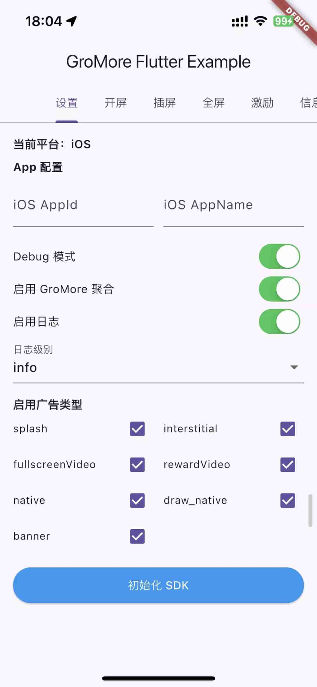
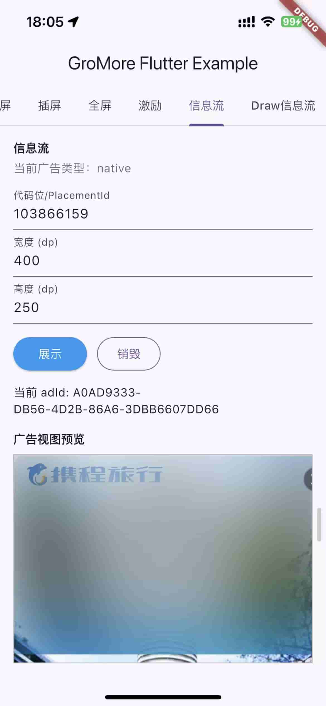
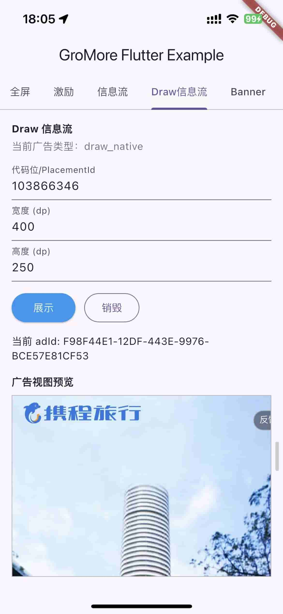
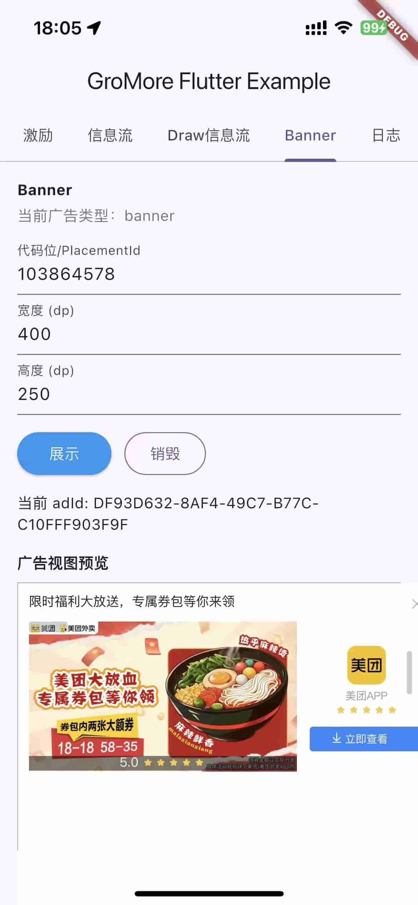
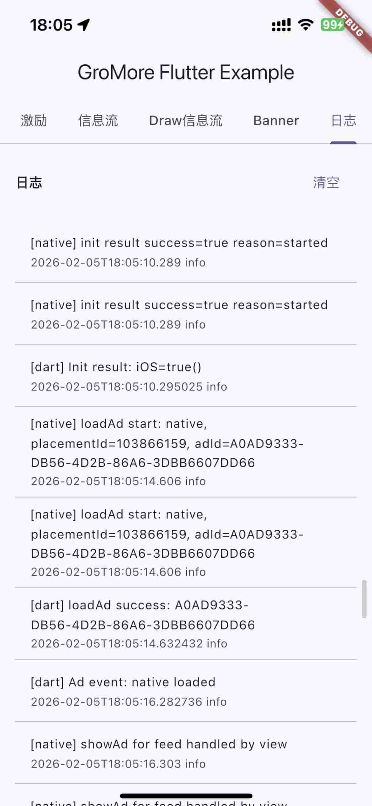

# Flutter GroMore Ads

[](doc/README.zh-CN.md)


An actively maintained GroMore ad mediation plugin for Flutter, with Android
and iOS support, multiple ad formats, event callbacks, and multiple ad network
(ADN) configurations.

> This is a source-available project. Forks are permitted only for evaluation,
> testing, fixing issues, and contributing changes back through pull requests.
> Republishing this project or a modified version as an independent plugin,
> SDK, package, or competing product is not permitted. See [LICENSE](LICENSE),
> the [Chinese explanation](LICENSE.zh-CN.md), and
> [contribution guidelines](CONTRIBUTING.md).

## Features

- Splash ads.
- Interstitial ads.
- Fullscreen video ads.
- Banner ads.
- Rewarded video ads.
- Native feed ads, including template/Express ads and built-in default styles
  for self-rendered ads.
- Draw feed ads.

## Screenshots

<div align="center">
  
  
  
  
  
</div>

## Requirements

- Android: minimum SDK 24.
- iOS: 13.0 or later.

## Quick Start

Current plugin version: `2.2.2`. Bundled SDKs: Android GroMore `7.8.1.4`
and iOS Ads-CN-Beta `7.8.0.5`.

### 1. Add the dependency

```yaml
dependencies:
  gromore_flutter: ^2.2.2
```

Run:

```bash
flutter pub get
```

### 2. Initialize the SDK

For a standard single-process app, provide the App ID for the current platform:

```dart
import 'package:flutter/foundation.dart';
import 'package:gromore_flutter/gromore_flutter.dart';

final result = await GromoreFlutter.instance.initialize(
  androidAppId: 'your_android_app_id', // For Android
  iosAppId: 'your_ios_app_id' // For iOS
);
```

Initialization returns an `InitResult`. Read `result.android` or `result.ios`
when you need to display initialization errors.

The following settings have defaults and do not need to be supplied for a
standard integration:

- `androidAppName`: Android reads the application name automatically.
- `iosAppName`: retained for compatibility with older configurations; the
  current iOS SDK does not depend on it during initialization.
- `debug`: disabled by default.
- `useMediation`: enabled by default.
- `enabledAdTypes`: all ad formats are enabled by default.
- `enableLog`: enabled in Debug builds and disabled in Release builds by default.

To disable optional data collection before the user grants privacy consent,
pass the privacy configuration explicitly:

```dart
await GromoreFlutter.instance.initialize(
  androidAppId: 'your_android_app_id',
  iosAppId: 'your_ios_app_id',
  privacy: GromorePrivacyConfig.disableAll(),
);
```

### Advanced initialization (optional)

`initialize(...)` is a shortcut for standard integrations and handles only
App IDs and privacy configuration. To restrict ad formats, explicitly control
logging, or provide platform-specific options, use `init(GromoreConfig(...))`:

```dart
final result = await GromoreFlutter.instance.init(
  const GromoreConfig(
    androidAppId: 'your_android_app_id',
    iosAppId: 'your_ios_app_id',
    // Enable only the ad formats your app uses; all are enabled if omitted.
    enabledAdTypes: {
      GromoreAdType.splash,
      GromoreAdType.rewardVideo,
    },
    // If omitted, logging is enabled in Debug and disabled in Release.
    enableLog: kDebugMode,
    enableLogToFile: false,
    // Include the following options only when the corresponding platform needs them.
    androidOptions: {
      'supportMultiProcess': true,
    },
    iosOptions: {
      'mediation': {
        'limitPersonalAds': 1,
      },
    },
  ),
);
```

Common configuration fields:

- `enabledAdTypes`: restricts the ad formats that can be loaded; all formats
  are enabled by default.
- `enableLog`: controls console logging. `enableLogToFile` additionally enables
  file logging.
- `debug`: controls the native SDK's Debug mode and is independent of `enableLog`.
- `useMediation`: enables GroMore mediation and defaults to `true`.
- `androidOptions` and `iosOptions`: configure platform-specific capabilities.
  Do not add them to a standard integration just to make the configuration
  appear complete.

For privacy controls, multi-process support, and native initialization, see
[Android setup](doc/android.md), [iOS setup](doc/ios.md), and
[privacy configuration](doc/privacy.md).

### 3. Load and show an ad

This example uses a splash ad. For complete examples of every ad format, see
[ad examples](doc/ad_examples.md).

```dart
final adId = await GromoreSplash.load(
  const GromoreSplashConfig(
    placementId: 'your_splash_placement_id',
    timeoutMillis: 3000,
  ),
);

final subscription = GromoreSplash.listen(
  adId: adId,
  callback: GromoreAdCallback(
    onShown: (_) => debugPrint('splash shown'),
    onClosed: (_) => debugPrint('splash closed'),
    onFailed: (event) => debugPrint(
      'splash failed: ${event.errorCode} ${event.errorMessage}',
    ),
  ),
);

await GromoreSplash.show(adId);

// Cancel the subscription and dispose of the ad when the page is disposed.
await subscription.cancel();
await GromoreSplash.dispose(adId);
```

See [ad examples](doc/ad_examples.md) for all formats and rewarded video
server verification using `userId` and `customData`.

## Ad Formats

| Format | API | Embedded view |
| --- | --- | --- |
| [Splash](doc/ad_examples.md#-开屏广告) | `GromoreSplash` | No |
| [Interstitial](doc/ad_examples.md#-插屏广告) | `GromoreInterstitial` | No |
| [Fullscreen video](doc/ad_examples.md#-全屏视频) | `GromoreFullscreenVideo` | No |
| [Rewarded video](doc/ad_examples.md#-激励视频) | `GromoreReward` | No |
| [Banner](doc/ad_examples.md#-banner) | `GromoreBanner` | Yes |
| [Native feed](doc/ad_examples.md#-信息流) | `GromoreFeed` | Yes |
| [Draw feed](doc/ad_examples.md#-draw-信息流) | `GromoreDraw` | Yes |

Video and splash ads follow the `load -> listen -> show` pattern. For banner,
native feed, and Draw feed ads, pass the loaded `adId` to the corresponding view:

```dart
GromoreBannerView(
  adId: bannerId,
  width: 320,
  height: 150,
)
```

For the complete ad API, callbacks, rendered dimensions, visibility detection,
and resource cleanup, see [ad examples](doc/ad_examples.md).

## Platform Setup

Basic Android network permissions and `TTFileProvider` are merged by the plugin.
You do not need to add them again for a standard integration.

Additional platform configuration is needed only in the following scenarios:

- Android multi-process apps, or apps where the host controls initialization
  after privacy consent.
- iOS apps using ATT, additional ad networks, or specific system capabilities.
- Android/iOS integrations with third-party ad networks such as Tencent GDT,
  Baidu, Kuaishou, or AdMob.

Refer to the guides relevant to your integration:

- [Android setup, multi-process initialization, and ad networks](doc/android.md)
- [iOS setup, ATT, and ad networks](doc/ios.md)
- [Privacy and data collection](doc/privacy.md)

## Events

Use `GromoreAdCallback` to handle ad events:

```dart
GromoreAdCallback(
  onLoaded: (_) {},
  onRendered: (_) {},
  onShown: (_) {},
  onClicked: (_) {},
  onClosed: (_) {},
  onCompleted: (_) {},
  onSkipped: (_) {},
  onRewarded: (_) {},
  onFailed: (_) {},
)
```

Common events:

- `onLoaded`: the ad loaded successfully.
- `onRendered`: a template or native feed ad finished rendering.
- `onShown`: the ad was displayed.
- `onClosed`: the ad was closed, including when a native feed ad is closed.
- `onRewarded`: the reward was granted.
- `onFailed`: loading or displaying the ad failed.

## Frequently Asked Questions

### Is Android Manifest configuration required?

Not for a standard single-process app. Pass `androidAppId` in `GromoreConfig`.
Manifest configuration is needed only for multi-process support, automatic
initialization, or initialization controlled by the native host.

### Is ATT required on iOS?

No. Call `requestATT()` only when your app needs IDFA or personalized advertising
authorization, and configure `NSUserTrackingUsageDescription` in `Info.plist`.

### Is the `privacy` configuration required?

No. Use `GromorePrivacyConfig` only when you need to restrict data collection
before the user accepts your privacy policy.

### Do I need to configure every ad format?

No. All ad formats are enabled by default through `enabledAdTypes`. Provide a
restricted set only when you need to limit the available formats.

### How do I integrate a third-party ad network?

First check the platform-specific SDK, adapter, App ID, permission, and
`Info.plist`/Manifest requirements. Then follow [iOS setup](doc/ios.md) or
[Android setup](doc/android.md).

For more help, see [troubleshooting](doc/troubleshooting.md).

## Documentation

The detailed guides below are in Chinese:

- [Full Chinese setup guide](doc/README.zh-CN.md)
- [Android setup and ad networks](doc/android.md)
- [Android native initialization](doc/android_host_integration_template.md)
- [iOS setup, ATT, and ad networks](doc/ios.md)
- [Privacy configuration](doc/privacy.md)
- [Ad examples and callbacks](doc/ad_examples.md)
- [Logging and debug tools](doc/logging.md)
- [Troubleshooting](doc/troubleshooting.md)

Release history is available in the [Chinese changelog](CHANGELOG.md).

## License and Contact

This project uses a custom source-available license. It permits evaluation,
testing, and contribution, with restrictions on redistribution and derivative
products. Review [LICENSE](LICENSE), the [Chinese explanation](LICENSE.zh-CN.md),
and [contribution guidelines](CONTRIBUTING.md) before use.

Contact: [xm_sean@163.com](mailto:xm_sean@163.com).


